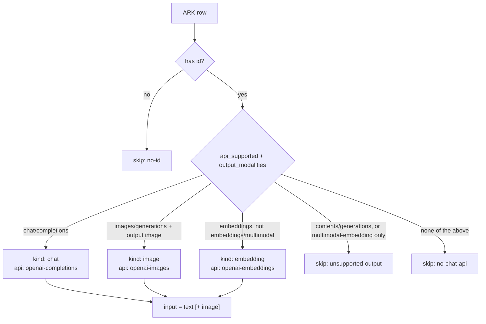

# ARK → omp field mapping

Reference: [`GET /api/v3/models`](https://console.volcengine.com/ark/region:cn-beijing/docs/models-api)
and [`docs/ark-models-api.md`](ark-models-api.md) for the captured fields.
Everything below was confirmed against a live payload
(`test/fixtures/ark-models.sample.json`, 54 rows) and, where marked, against the
API itself.

The same mapper also feeds pi (`@earendil-works/pi-coding-agent`); the extra step
that converts these rows to pi's `ProviderModelConfig` (thinking map, token field,
image api, refresh lifecycle) is [pi-compatibility.md](pi-compatibility.md).

## Row selection

A row becomes a model only if omp can actually talk to it.

Why skip instead of registering: omp validates `kind` against `api`
(`fetchDynamicModels row dropped: its api does not serve its kind`) and silently
drops mismatches. Registering a video model on `openai-completions` would either
be dropped or, worse, send chat requests to `contents/generations`.

## Field table

| omp field | Source in ARK | Rule |
|---|---|---|
| `id` | `id` | Required. Duplicates are last-wins. |
| `name` | `name` + `version` | `"<name> (<version>)"` unless the name already contains the version. Versions share a `name`, so the suffix is what makes 27 chat rows distinguishable. |
| `api` | `api_supported` + `modalities.output_modalities` | See the flow above. `chat/completions` → `openai-completions`. Text embeddings are keyed off `api_supported.embeddings` alone, because ARK omits the whole `modalities` block on those rows. |
| `kind` | derived from `api` | `chat` / `image` / `embedding`. |
| `input` | `modalities.input_modalities` | Always `["text"]`, plus `"image"` when ARK lists it. `video`/`audio` are **dropped**. |
| `contextWindow` | `token_limits.context_window` → `context_window` | First positive integer. Fallback 128000 only when both are absent (`doubao-smart-router-250928`). |
| `maxTokens` | `token_limits.max_output_token_length` → `max_output_tokens` | First positive integer, then clamped to `contextWindow`. Fallback 32768. |
| `reasoning` | `effort.supported_levels` | `true` when at least one dialable level exists. |
| `thinking.mode` | — | Always `"effort"`; ARK's ladder is effort-shaped. |
| `thinking.efforts` | `effort.supported_levels` | Keep omp's ladder order (`minimal`,`low`,`medium`,`high`,`max`), dedupe, drop anything else including ARK's `"none"`. |
| `thinking.defaultLevel` | `effort.default_level` | Only when it survives the filter; otherwise the lowest effort. |
| `supportsTools` | `features.tools.function_calling` | Copied when present. |
| `cost` | — | Zeros. ARK's model list carries no pricing; leaving `cost` out makes omp look the model up in its catalog and pick up prices for a *different* vendor's model with the same name. |
| `compat.maxTokensField` | — | Always `"max_tokens"`. |
| `compat.supportsReasoningEffort` | — | `true` on reasoning rows. |
| `compat.reasoningDisableMode` | — | `"none-effort"` on reasoning rows. |

### Why `input` never contains `video`

ARK advertises `video` on 16 chat rows and `audio` on 3. omp's `input` schema accepts only `text`
and `image`; a `video` entry fails validation for the **whole** models file and
disables every custom provider (`models.yml validation failed — custom providers
disabled`). The models do accept video, but omp has no way to send it, so the
declaration is dropped rather than the model.

### Why `none` is not an effort

ARK spells the off switch as a level (`"none"` appears in `supported_levels` on 6
models). omp models "off" as *absence* of a level plus a disable mode, so `none`
is filtered out of `efforts` and becomes
`compat.reasoningDisableMode: "none-effort"`, which makes omp send
`reasoning_effort: "none"`.

Every reasoning row gets `none-effort`, not only the ones advertising `none`.
Without it omp falls back to `lowest-effort`, which still requests reasoning:

| model | advertises `none` | `reasoning_effort: "none"` |
|---|---|---|
| `deepseek-v4-1-flash-261017` | yes | 200, 0 reasoning tokens |
| `glm-5-3-flash-260828` | no | 200, 2 reasoning tokens (≈ off) |
| `glm-5-2-260617` | yes | 200, 0 reasoning tokens |
| `deepseek-v4-flash-ga-260731` | yes | 200, 0 reasoning tokens |

ARK does not reject unadvertised levels: `xhigh` on `glm-5-3-flash-260828` also
returned 200 (488 reasoning tokens). So advertising `none` is a hint, not a gate.

### Why not `compat.whenThinking` / `extraBody.thinking`

`thinking: {type: enabled}` injected on every request forces thinking on and makes
`--thinking off` impossible — this was the actual bug in the hand-written
`models.yml` entries. ARK also accepts `thinking: {type: "disabled"}` as an off
switch (verified: 0 reasoning tokens on `deepseek-v4-1-flash-261017`,
`glm-5-2-260617`, `glm-5-3-flash-260828`), but effort is the field omp drives by
default, so one mechanism is enough.

## omp-side constraints this mapping respects

| Constraint | Consequence |
|---|---|
| `input` accepts only `text`, `image` | `video`/`audio` filtered. |
| `kind` must be served by `api` | Rows routed or skipped, never forced. |
| `apiKey` or `oauth` required when registering models | Provider always sets `apiKey: "ARK_API_KEY"`. |
| `fetchDynamicModels` has a 15 s timeout | One `GET /models`, no pagination, no per-model probes. |
| `thinking` needs a non-empty `efforts` | `thinking` omitted entirely when no level is dialable. |
| A failed discovery call disables the provider | `loadArkRows` returns `[]` on error rather than throwing, and keeps the cached catalog when one exists. |

## pi-side constraints this mapping respects

| Constraint | Consequence |
|---|---|
| `apiKey` is interpolated (`$NAME`), unset names are used literally | pi gets `"$ARK_API_KEY"`, omp keeps `"ARK_API_KEY"`. |
| `detectCompat` sees ARK as stock OpenAI | `compat.maxTokensField: "max_tokens"` is set explicitly on every chat row. |
| No embedding model type | 4 embedding rows dropped; the 27 chat rows are unaffected. |
| `thinkingLevelMap` drives the offered levels | Unadvertised levels are `null`, not omitted. |
| `refreshModels` replaces `models` instead of merging | Registration starts with `models: []`; the refresh is the only source. |
| `--list-models`/`-p` never allow network | Stored rows are returned verbatim in those modes. |
| A throw is a provider-wide refresh error | Failure returns the stored rows and logs. |
| Image models are invisible to the picker | Reached through `models.generateImages()`; registered under a custom `ark-images` api. |
